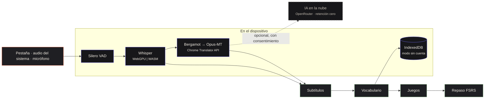

<div align="center">

# Frasy

**Aprende un idioma con lo que ya ves, juegas y conversas.**
Subtítulos y traducción en vivo de cualquier audio de tu computadora, ejecutándose **en tu propio dispositivo**, convertidos en juegos de vocabulario y repetición espaciada.

[🇺🇸 English](README.md) · [🇧🇷 Português](README.pt-BR.md) · [🇨🇳 中文](README.zh-CN.md) · [🇫🇷 Français](README.fr.md) · [🇪🇸 Español](README.es.md)

[](https://github.com/GuilhermeLVL/babel-play/actions/workflows/ci.yml)
[](https://github.com/GuilhermeLVL/babel-play/actions/workflows/seguranca.yml)
[](LICENSE)
[](package.json)


</div>

> **Estado (18/10/2026):** prelanzamiento. El cobro y el inicio de sesión están implementados y probados, y el despliegue en Cloudflare Workers funciona en staging; la producción aún no está en el aire. El [estado del lanzamiento](docs/ESTADO-DO-LANCAMENTO.md) (en portugués) es la única fuente de lo que vale hoy.

**Contenido:** [Qué es](#qué-es) · [Cómo ejecutarlo](#cómo-ejecutarlo) · [Arquitectura](#arquitectura) · [Planes e IA en la nube](#planes-e-ia-en-la-nube) · [Autoalojamiento](#autoalojamiento) · [Despliegue](#despliegue) · [Seguridad y privacidad](#seguridad-y-privacidad) · [Contribuir](#contribuir) · [Licencia](#licencia)

## Qué es

- **Subtítulos y traducción en vivo** de una pestaña del navegador, del audio del sistema (loopback de Windows) o del micrófono. Los subtítulos flotantes se muestran sobre el video o el juego.
- **Modo intérprete**: dos personas que no comparten idioma conversan cara a cara con un solo dispositivo; la traducción se lee en voz alta (voz del dispositivo en Gratis, voz natural de la nube en Premium).
- **Estudio** con repetición espaciada FSRS-5 y una ruta CEFR construida con listas de palabras reales, alimentada por lo que escuchaste.
- **Juegos**: nueve juegos cortos creados con _tu_ vocabulario (memoria, sopa de letras, dictado, duelo relámpago, karaoke...). Lo que aciertas cuenta en el repaso.
- **Importación** de mazos Anki, documentos (`.txt`, `.pdf`, `.docx`) y subtítulos (`.srt`, `.vtt`, `.ass`), leídos en el navegador.
- **Local-first**: los modelos se ejecutan en el dispositivo (Whisper con transformers.js sobre WebGPU con respaldo en WASM, Opus-MT y Bergamot, de Mozilla, para traducción rápida X→inglés). Sin cuenta, nada se envía al servidor.
- **Nube opcional** (OpenRouter, retención cero de datos, con consentimiento explícito) para más calidad cuando lo pidas.
- **Perfil protegido para menores**: sin compras, sin ofertas, y IA en la nube solo con fecha de nacimiento declarada.

## Cómo ejecutarlo

Requiere Node 22 o superior.

```bash
npm install          # también copia los binarios de ONNX Runtime / Silero VAD a public/
cp .env.example .env # define PORT; el pipeline local no necesita clave de API
npm run dev          # Express + Vite en un solo proceso → http://localhost:<PORT>
```

Ábrelo desde `localhost` (contexto seguro, exigido por los modelos). Si tu `.env` tiene `VITE_AUTH_REQUIRED=1`, usa `npm run dev:local`: inicia la misma aplicación con el inicio de sesión desactivado, para inspección local. En la pantalla de acceso, elige **Continuar sin cuenta** para usar todo el pipeline local.

| Comando                             | Qué hace                                                                                          |
| ----------------------------------- | ------------------------------------------------------------------------------------------------- |
| `npm run dev` / `npm run dev:local` | servidor de desarrollo (el segundo con el inicio de sesión desactivado)                           |
| `npm test`                          | pruebas unitarias y de integración (Vitest)                                                       |
| `npm run test:e2e`                  | pruebas de extremo a extremo (Playwright)                                                         |
| `npm run lint`                      | ESLint, sin ninguna advertencia permitida                                                         |
| `npm run typecheck`                 | TypeScript (también `typecheck:core` y `typecheck:estrito`)                                       |
| `npm run build`                     | bundle del cliente (`dist/`) y del servidor (`dist-server/`)                                      |
| `npm run vitrine`                   | modo público completo con inicio de sesión y cobro simulados ([docs/vitrine.md](docs/vitrine.md)) |

La lista completa que ejecuta la CI está en [CONTRIBUTING.md](CONTRIBUTING.md) (en inglés).

## Arquitectura



El código se divide en capas:

| Ruta              | Función                                                                                                                                                                         |
| ----------------- | ------------------------------------------------------------------------------------------------------------------------------------------------------------------------------- |
| `src/core/`       | lógica de dominio pura (planes, FSRS, juegos, economía, reglas de traducción); sin DOM, sin red                                                                                 |
| `src/gateway/`    | adaptadores de voz a texto y de traducción, caché de modelos, enrutamiento y respaldos entre proveedores                                                                        |
| `src/lib/`        | servicios del cliente: captura, audio, voz, importación, autenticación                                                                                                          |
| `src/data/`       | la capa de datos. `apiFetch` es el **embudo HTTP único**; sin cuenta, un servidor en memoria sobre IndexedDB (`src/data/efemero`) responde con los mismos formatos de respuesta |
| `src/components/` | interfaz en React                                                                                                                                                               |
| `server/`         | API Express: JWT de Supabase, aislamiento por usuario, límites de tasa, validación con Zod, libsql/SQLite (Drizzle), cobro, enrutamiento de IA                                  |

Identidad (anónima o con cuenta), plan y rol son ejes separados, y el plan lo decide **solo** el servidor; el cliente únicamente lo muestra. Una regla de ast-grep prohíbe `fetch('/api/…')` fuera del embudo. Más en [docs/arquitetura.md](docs/arquitetura.md) (histórico) y en las especificaciones vivas de [`openspec/specs/`](openspec/specs/).

## Planes e IA en la nube

| Plan        | Qué recibes                                                                                                                                                                                                          |
| ----------- | -------------------------------------------------------------------------------------------------------------------------------------------------------------------------------------------------------------------- |
| **Gratis**  | Todo lo que se ejecuta en el dispositivo (captura, modelos locales, estudio, juegos). Sin IA gestionada en la nube.                                                                                                  |
| **Premium** | Transcripción y traducción en la nube con uso justo diario y mensual, voz natural en el intérprete. Empieza con una prueba sin tarjeta que termina a los 14 días o al agotar la cuota de uso, lo que ocurra primero. |

La IA en la nube pasa por OpenRouter con retención cero de datos y solo tras el consentimiento. Los precios, las cuotas y las decisiones detrás están en [docs/ESTADO-DO-LANCAMENTO.md](docs/ESTADO-DO-LANCAMENTO.md) y [docs/monetizacao.md](docs/monetizacao.md). El pago se hace con Asaas, y quien concede el plan es el webhook del pago.

## Autoalojamiento

Docker (en macOS sirve OrbStack) con el modo público multiusuario:

```bash
cp .env.docker.example .env.docker   # completa los valores de Supabase
docker compose --env-file .env.docker up -d --build
curl -fsS http://localhost:3000/api/health
```

El HTTPS corre por cuenta del proxy inverso al frente (Caddy, Traefik, nginx). Detalles en [`docker-compose.yml`](docker-compose.yml) y en [docs/deploy.md](docs/deploy.md).

## Despliegue

El destino de producción es Cloudflare Workers (el mismo servidor Express, Postgres en Supabase en São Paulo mediante Hyperdrive, R2 para medios y copia de seguridad semanal con `pg_dump`; ver [ADR 0015](docs/adr/0015-cloudflare-workers-no-lugar-do-fly.md)), con Supabase para el inicio de sesión, Resend y Sentry. El autoalojamiento sigue disponible con Docker/Node. La guía paso a paso del propietario es [docs/LANCAMENTO.md](docs/LANCAMENTO.md); la operación es [docs/runbook.md](docs/runbook.md); el staging es [docs/STAGING.md](docs/STAGING.md). El despliegue pasa por `deploy-worker.yml`, por versiones de Cloudflare, con prueba de humo y reversión automática.

## Seguridad y privacidad

- Las vulnerabilidades se reportan en privado; consulta [SECURITY.md](SECURITY.md).
- Registros de la LGPD (registro de operaciones de tratamiento y encargados): [docs/lgpd/](docs/lgpd/).
- El modo sin cuenta envía **cero** solicitudes a `/api`; nada escrito por el usuario llega a los logs; el audio solo se conserva el tiempo que indica la política de retención.
- La CI ejecuta SAST (Semgrep), auditoría de dependencias con lista de excepciones nombrada, escaneo de secretos, Trivy sobre la imagen y una sonda de ataques al JWT.
- El método de auditoría está en [docs/metodologia-de-auditoria.md](docs/metodologia-de-auditoria.md); las auditorías fechadas están en [docs/auditoria/](docs/auditoria/).

## Límites conocidos

- Opus-MT int8/fp16 no logra crear la sesión en algunos dispositivos; la aplicación recurre al siguiente traductor.
- El audio al compartir pantalla en Windows puede producir `NotReadableError`; usa compartir pestaña o el loopback.
- Base de datos con un único escritor (SQLite): sirve para una beta; escalar significa cambiar de base de datos, ver [docs/escala.md](docs/escala.md).
- Los modelos de Bergamot se sirven desde un CDN que el propietario aún debe publicar; hasta entonces, Opus-MT hace el trabajo.

## Contribuir

Lee [CONTRIBUTING.md](CONTRIBUTING.md) y el [Código de Conducta](CODE_OF_CONDUCT.md). Los cambios de comportamiento en sistemas existentes pasan por [OpenSpec](openspec/) (`/opsx:propose`). Un hook de pre-commit ([Husky](.husky/pre-commit) + lint-staged) formatea y ejecuta el lint sobre lo que está en el índice. El índice de toda la documentación es [docs/README.md](docs/README.md); las atribuciones de datos están en [docs/FONTES.md](docs/FONTES.md) (en portugués).

## Licencia

[MIT](LICENSE).
