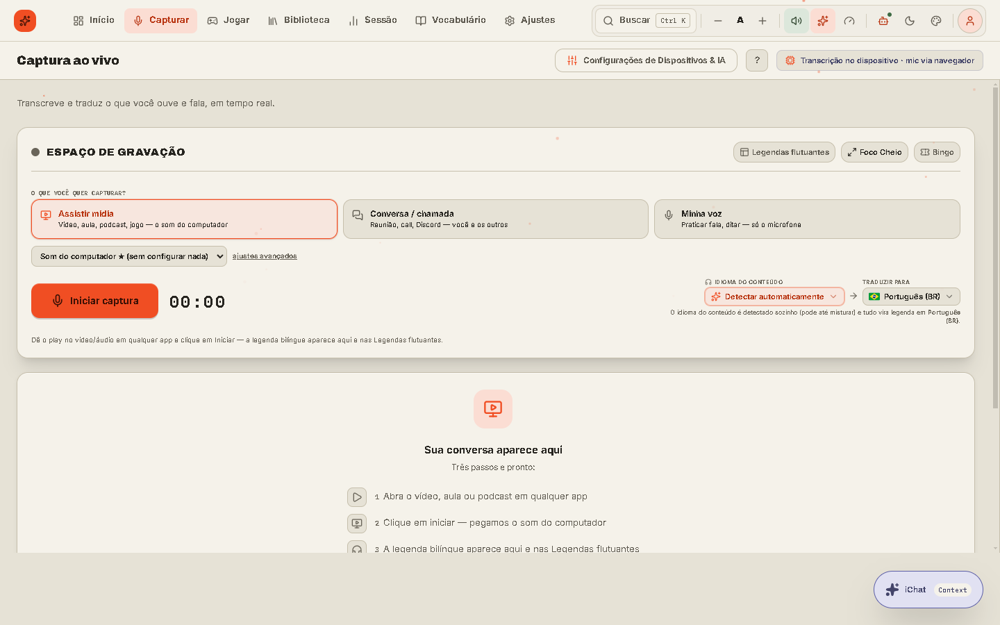
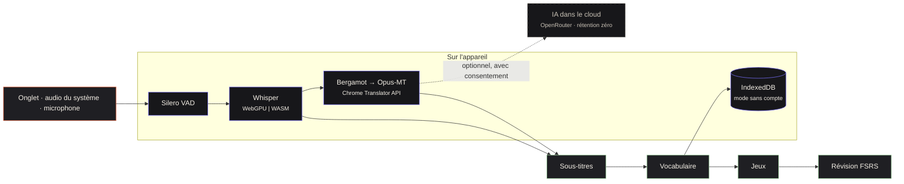

<div align="center">

# Frasy

**Apprenez une langue avec ce que vous regardez, jouez et dites déjà.**
Sous-titres et traduction en direct de n'importe quel audio de votre ordinateur, exécutés **sur votre propre appareil**, transformés en jeux de vocabulaire et en répétition espacée.

[🇺🇸 English](README.md) · [🇧🇷 Português](README.pt-BR.md) · [🇨🇳 中文](README.zh-CN.md) · [🇫🇷 Français](README.fr.md) · [🇪🇸 Español](README.es.md)

[](https://github.com/GuilhermeLVL/babel-play/actions/workflows/ci.yml)
[](https://github.com/GuilhermeLVL/babel-play/actions/workflows/seguranca.yml)
[](LICENSE)
[](package.json)



</div>

> **État (18/10/2026) :** pré-lancement. La facturation et la connexion sont implémentées et testées, et le déploiement sur Cloudflare Workers tourne en staging ; la production n'est pas encore en ligne. L'[état du lancement](docs/ESTADO-DO-LANCAMENTO.md) (en portugais) est la source unique de ce qui vaut aujourd'hui.

**Sommaire :** [Ce que c'est](#ce-que-cest) · [Lancer](#lancer) · [Architecture](#architecture) · [Offres et IA dans le cloud](#offres-et-ia-dans-le-cloud) · [Auto-hébergement](#auto-hébergement) · [Déploiement](#déploiement) · [Sécurité et confidentialité](#sécurité-et-confidentialité) · [Contribuer](#contribuer) · [Licence](#licence)

## Ce que c'est

- **Sous-titres et traduction en direct** d'un onglet du navigateur, de l'audio du système (loopback Windows) ou du microphone. Les sous-titres flottants s'affichent par-dessus la vidéo ou le jeu.
- **Mode interprète** : deux personnes qui ne partagent pas de langue discutent face à face avec un seul appareil ; la traduction est lue à voix haute (voix de l'appareil en Gratuit, voix naturelle du cloud en Premium).
- **Étude** avec répétition espacée FSRS-5 et un parcours CECR construit à partir de vraies listes de mots, alimenté par ce que vous avez entendu.
- **Jeux** : neuf jeux courts construits avec _votre_ vocabulaire (mémoire, mots mêlés, dictée, duel éclair, karaoké...). Ce que vous réussissez compte dans la révision.
- **Import** de paquets Anki, de documents (`.txt`, `.pdf`, `.docx`) et de sous-titres (`.srt`, `.vtt`, `.ass`), lus dans le navigateur.
- **Local-first** : les modèles tournent sur l'appareil (Whisper via transformers.js sur WebGPU avec repli WASM, Opus-MT et Bergamot, de Mozilla, pour une traduction rapide X→anglais). Sans compte, rien n'est envoyé au serveur.
- **Cloud optionnel** (OpenRouter, rétention zéro des données, avec consentement explicite) pour plus de qualité quand vous le demandez.
- **Profil protégé pour les mineurs** : pas d'achat, pas d'offre, et IA dans le cloud seulement avec une date de naissance déclarée.

## Lancer

Nécessite Node 22 ou plus récent.

```bash
npm install          # copie aussi les binaires ONNX Runtime / Silero VAD dans public/
cp .env.example .env # définissez PORT ; le pipeline local n'a pas besoin de clé d'API
npm run dev          # Express + Vite dans un seul processus → http://localhost:<PORT>
```

Ouvrez via `localhost` (contexte sécurisé, exigé par les modèles). Si votre `.env` contient `VITE_AUTH_REQUIRED=1`, utilisez `npm run dev:local` : il démarre la même application avec la connexion désactivée, pour une inspection locale. Sur l'écran de connexion, choisissez **Continuer sans compte** pour utiliser tout le pipeline local.

| Commande                            | Ce qu'elle fait                                                                                 |
| ----------------------------------- | ----------------------------------------------------------------------------------------------- |
| `npm run dev` / `npm run dev:local` | serveur de développement (le second avec la connexion désactivée)                               |
| `npm test`                          | tests unitaires et d'intégration (Vitest)                                                       |
| `npm run test:e2e`                  | tests de bout en bout (Playwright)                                                              |
| `npm run lint`                      | ESLint, aucun avertissement toléré                                                              |
| `npm run typecheck`                 | TypeScript (aussi `typecheck:core` et `typecheck:estrito`)                                      |
| `npm run build`                     | bundle client (`dist/`) et serveur (`dist-server/`)                                             |
| `npm run vitrine`                   | mode public complet avec connexion et facturation factices ([docs/vitrine.md](docs/vitrine.md)) |

La liste complète exécutée par la CI se trouve dans [CONTRIBUTING.md](CONTRIBUTING.md) (en anglais).

## Architecture



Le code est découpé en couches :

| Chemin            | Rôle                                                                                                                                                                                      |
| ----------------- | ----------------------------------------------------------------------------------------------------------------------------------------------------------------------------------------- |
| `src/core/`       | logique de domaine pure (offres, FSRS, jeux, économie, règles de traduction) ; sans DOM, sans réseau                                                                                      |
| `src/gateway/`    | adaptateurs de reconnaissance vocale et de traduction, cache des modèles, routage et replis entre fournisseurs                                                                            |
| `src/lib/`        | services du client : capture, audio, voix, import, authentification                                                                                                                       |
| `src/data/`       | la couche de données. `apiFetch` est l'**entonnoir HTTP unique** ; sans compte, un serveur en mémoire au-dessus d'IndexedDB (`src/data/efemero`) répond avec les mêmes formats de réponse |
| `src/components/` | interface React                                                                                                                                                                           |
| `server/`         | API Express : JWT Supabase, isolation par utilisateur, limites de débit, validation Zod, libsql/SQLite (Drizzle), facturation, routage de l'IA                                            |

Identité (anonyme ou avec compte), offre et rôle sont des axes séparés, et l'offre est décidée **uniquement** par le serveur ; le client ne fait que l'afficher. Une règle ast-grep interdit `fetch('/api/…')` en dehors de l'entonnoir. Plus de détails dans [docs/arquitetura.md](docs/arquitetura.md) (historique) et dans les spécifications vivantes de [`openspec/specs/`](openspec/specs/).

## Offres et IA dans le cloud

| Offre       | Ce que vous obtenez                                                                                                                                                                                                                           |
| ----------- | --------------------------------------------------------------------------------------------------------------------------------------------------------------------------------------------------------------------------------------------- |
| **Gratuit** | Tout ce qui tourne sur l'appareil (capture, modèles locaux, étude, jeux). Pas d'IA gérée dans le cloud.                                                                                                                                       |
| **Premium** | Transcription et traduction dans le cloud avec usage équitable quotidien et mensuel, voix naturelle de l'interprète. Commence par un essai sans carte, qui prend fin au bout de 14 jours ou au quota d'usage, selon ce qui arrive en premier. |

L'IA dans le cloud passe par OpenRouter avec rétention zéro des données et seulement après consentement. Les prix, les quotas et les décisions qui les sous-tendent sont dans [docs/ESTADO-DO-LANCAMENTO.md](docs/ESTADO-DO-LANCAMENTO.md) et [docs/monetizacao.md](docs/monetizacao.md). Le paiement passe par Asaas, et c'est le webhook du paiement qui accorde l'offre.

## Auto-hébergement

Docker (sur macOS, OrbStack convient) avec le mode public multi-utilisateur :

```bash
cp .env.docker.example .env.docker   # renseignez les valeurs Supabase
docker compose --env-file .env.docker up -d --build
curl -fsS http://localhost:3000/api/health
```

Le HTTPS est géré par le proxy inverse placé devant (Caddy, Traefik, nginx). Détails dans [`docker-compose.yml`](docker-compose.yml) et [docs/deploy.md](docs/deploy.md).

## Déploiement

La cible de production est Cloudflare Workers (le même serveur Express, Postgres sur Supabase à São Paulo via Hyperdrive, R2 pour les médias et sauvegarde hebdomadaire par `pg_dump` ; voir l'[ADR 0015](docs/adr/0015-cloudflare-workers-no-lugar-do-fly.md)), avec Supabase pour la connexion, Resend et Sentry. L'auto-hébergement reste possible avec Docker/Node. Le pas-à-pas du propriétaire est [docs/LANCAMENTO.md](docs/LANCAMENTO.md) ; l'exploitation est [docs/runbook.md](docs/runbook.md) ; le staging est [docs/STAGING.md](docs/STAGING.md). Le déploiement passe par `deploy-worker.yml`, par versions Cloudflare, avec test de fumée et retour arrière automatique.

## Sécurité et confidentialité

- Les vulnérabilités se signalent en privé ; voir [SECURITY.md](SECURITY.md).
- Registres LGPD (registre des traitements et sous-traitants) : [docs/lgpd/](docs/lgpd/).
- Le mode sans compte envoie **zéro** requête à `/api` ; rien de ce que l'utilisateur saisit n'arrive dans les logs ; l'audio n'est conservé que le temps prévu par la politique de rétention.
- La CI exécute SAST (Semgrep), audit des dépendances avec liste d'exceptions nommée, détection de secrets, Trivy sur l'image et une sonde d'attaques JWT.
- La méthode d'audit est dans [docs/metodologia-de-auditoria.md](docs/metodologia-de-auditoria.md) ; les audits datés sont dans [docs/auditoria/](docs/auditoria/).

## Limites connues

- Opus-MT int8/fp16 ne parvient pas à créer la session sur certains appareils ; l'application bascule sur le traducteur suivant.
- L'audio du partage d'écran sous Windows peut lever `NotReadableError` ; utilisez le partage d'onglet ou le loopback.
- Base de données à écrivain unique (SQLite) : suffisant pour une bêta ; passer à l'échelle implique de changer de base, voir [docs/escala.md](docs/escala.md).
- Les modèles Bergamot sont servis depuis un CDN que le propriétaire doit encore publier ; d'ici là, Opus-MT fait le travail.

## Contribuer

Lisez [CONTRIBUTING.md](CONTRIBUTING.md) et le [Code de conduite](CODE_OF_CONDUCT.md). Les changements de comportement dans des systèmes existants passent par [OpenSpec](openspec/) (`/opsx:propose`). Un hook de pre-commit ([Husky](.husky/pre-commit) + lint-staged) formate et lint ce qui est indexé. L'index de toute la documentation est [docs/README.md](docs/README.md) ; les attributions des données sont dans [docs/FONTES.md](docs/FONTES.md) (en portugais).

## Licence

[MIT](LICENSE).
