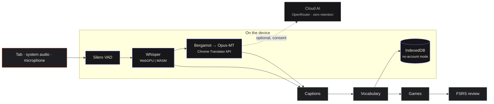

<div align="center">

# Frasy

**Learn a language from what you already watch, play and talk about.**
Live captions and translation of any audio on your computer, running **on your own device**, turned into vocabulary games and spaced repetition.

[🇺🇸 English](README.md) · [🇧🇷 Português](README.pt-BR.md) · [🇨🇳 中文](README.zh-CN.md) · [🇫🇷 Français](README.fr.md) · [🇪🇸 Español](README.es.md)

[](https://github.com/GuilhermeLVL/babel-play/actions/workflows/ci.yml)
[](https://github.com/GuilhermeLVL/babel-play/actions/workflows/seguranca.yml)
[](LICENSE)
[](package.json)


</div>

> **Status (2026-10-18):** pre-launch. Billing, login and the Fly.io deploy are implemented and tested but have not run in a real environment yet. See the [launch status](docs/ESTADO-DO-LANCAMENTO.md) (Portuguese), the single source for what holds today.

**Contents:** [What it is](#what-it-is) · [Run it](#run-it) · [Architecture](#architecture) · [Plans and cloud AI](#plans-and-cloud-ai) · [Self-hosting](#self-hosting) · [Deploy](#deploy) · [Security and privacy](#security-and-privacy) · [Contributing](#contributing) · [License](#license)

## What it is

- **Live captions and translation** of a browser tab, the system audio (Windows loopback) or the microphone. Floating captions go over the video or game.
- **Interpreter mode**: two people who do not share a language talk face to face on one device; the translation is read aloud (device voice on Free, natural cloud voice on Premium).
- **Study** with FSRS-5 spaced repetition and a CEFR track built from real word lists, fed by what you heard.
- **Games**: nine short games built from _your_ vocabulary (memory, word search, dictation, blitz duel, karaoke...). What you get right counts in the review.
- **Import** Anki decks, documents (`.txt`, `.pdf`, `.docx`) and subtitles (`.srt`, `.vtt`, `.ass`), read in the browser.
- **Local-first**: models run on the device (Whisper through transformers.js on WebGPU with a WASM fallback, Opus-MT, and Bergamot from Mozilla for fast X→English translation). Without an account, nothing is sent to the server.
- **Optional cloud** (OpenRouter, zero data retention, with explicit consent) for higher quality when you ask for it.
- **Protected profile for minors**: no purchases, no offers, and cloud AI only with a declared birth date.

## Run it

Requires Node 22 or newer.

```bash
npm install          # also copies the ONNX Runtime / Silero VAD binaries into public/
cp .env.example .env # set PORT; no API key is needed for the local pipeline
npm run dev          # Express + Vite in one process → http://localhost:<PORT>
```

Open it through `localhost` (a secure context, required by the models). If your `.env` has `VITE_AUTH_REQUIRED=1`, use `npm run dev:local` instead: it starts the same app with login off, for local inspection. On the login screen, choose **Continue without an account** to use the whole local pipeline.

| Command                             | What it does                                                                      |
| ----------------------------------- | --------------------------------------------------------------------------------- |
| `npm run dev` / `npm run dev:local` | development server (the second one with login off)                                |
| `npm test`                          | unit and integration tests (Vitest)                                               |
| `npm run test:e2e`                  | end-to-end tests (Playwright)                                                     |
| `npm run lint`                      | ESLint, zero warnings allowed                                                     |
| `npm run typecheck`                 | TypeScript (also `typecheck:core`, `typecheck:estrito`)                           |
| `npm run build`                     | client bundle (`dist/`) and server bundle (`dist-server/`)                        |
| `npm run vitrine`                   | full public mode with fake login and billing ([docs/vitrine.md](docs/vitrine.md)) |

The full list CI runs is in [CONTRIBUTING.md](CONTRIBUTING.md).

## Architecture



The code is split in layers:

| Path              | Role                                                                                                                                                                       |
| ----------------- | -------------------------------------------------------------------------------------------------------------------------------------------------------------------------- |
| `src/core/`       | pure domain logic (plans, FSRS, games, economy, translation rules); no DOM, no network                                                                                     |
| `src/gateway/`    | adapters for speech-to-text and translation, model cache, routing and fallbacks between providers                                                                          |
| `src/lib/`        | client services: capture, audio, voice, import, auth                                                                                                                       |
| `src/data/`       | the data layer. `apiFetch` is the **single HTTP funnel**; without an account an in-memory server over IndexedDB (`src/data/efemero`) answers with the same response shapes |
| `src/components/` | React UI                                                                                                                                                                   |
| `server/`         | Express API: Supabase JWT, per-user isolation, rate limits, Zod validation, Postgres (Drizzle; PGlite in dev/tests, `pg` in production), billing, AI routing               |

Identity (anonymous or account), plan and role are separate axes, and the plan is decided **only** on the server; the client just paints it. An ast-grep rule forbids `fetch('/api/…')` outside the funnel. More in [docs/arquitetura.md](docs/arquitetura.md) (historical) and in the living specs under [`openspec/specs/`](openspec/specs/).

## Plans and cloud AI

| Plan        | What you get                                                                                                                                                                                               |
| ----------- | ---------------------------------------------------------------------------------------------------------------------------------------------------------------------------------------------------------- |
| **Free**    | Everything that runs on the device (capture, local models, study, games). No managed cloud AI.                                                                                                             |
| **Premium** | Cloud transcription and translation with fair daily and monthly use, natural interpreter voice. Starts with a trial with no card that ends after 14 days or at the usage allowance, whichever comes first. |

Cloud AI goes through OpenRouter with zero data retention and only after consent. Prices, quotas and the decisions behind them are in [docs/ESTADO-DO-LANCAMENTO.md](docs/ESTADO-DO-LANCAMENTO.md) and [docs/monetizacao.md](docs/monetizacao.md). Payment is handled by Asaas, and it is the payment webhook that grants the plan.

## Self-hosting

Docker (OrbStack on macOS works) with the multi-user public mode:

```bash
cp .env.docker.example .env.docker   # fill in the Supabase values
docker compose --env-file .env.docker up -d --build
curl -fsS http://localhost:3000/api/health
```

HTTPS is up to the reverse proxy in front (Caddy, Traefik, nginx). Details in [`docker-compose.yml`](docker-compose.yml) and [docs/deploy.md](docs/deploy.md).

## Deploy

The production target is Fly.io (GRU, one machine; the server now speaks Postgres, the Litestream/SQLite setup is legacy until the next migration phases, see [ADR 0014](docs/adr/0014-postgres-agora-pelo-cloudflare.md)), with Supabase for login, Cloudflare in front, Resend and Sentry. The owner's step-by-step is [docs/LANCAMENTO.md](docs/LANCAMENTO.md); operating it is [docs/runbook.md](docs/runbook.md); staging is [docs/STAGING.md](docs/STAGING.md). Deploys go through `deploy.yml`, which only accepts a commit with a green CI.

## Security and privacy

- Report vulnerabilities privately; see [SECURITY.md](SECURITY.md).
- LGPD records (data processing register and processors): [docs/lgpd/](docs/lgpd/).
- No-account mode sends **zero** requests to `/api`; nothing user-typed reaches the logs; audio is kept only as long as the retention policy says.
- CI runs SAST (Semgrep), dependency audit with a named allowlist, secret scanning, Trivy on the image and a JWT attack probe.
- The audit method is in [docs/metodologia-de-auditoria.md](docs/metodologia-de-auditoria.md); dated audits are in [docs/auditoria/](docs/auditoria/).

## Known limits

- Opus-MT int8/fp16 fails to build a session on some devices; the app falls back to the next translator.
- Screen-share audio on Windows can raise `NotReadableError`; use tab share or the loopback route.
- Dev/test database is PGlite (one process per directory); production needs Postgres, see [docs/escala.md](docs/escala.md).
- Bergamot models are served from a CDN that the owner still has to publish; until then Opus-MT does the work.

## Contributing

Read [CONTRIBUTING.md](CONTRIBUTING.md) and the [Code of Conduct](CODE_OF_CONDUCT.md). Behavior changes in existing systems go through [OpenSpec](openspec/) (`/opsx:propose`). A pre-commit hook ([Husky](.husky/pre-commit) + lint-staged) formats and lints what is staged. The index of all documentation is [docs/README.md](docs/README.md); data attributions are in [docs/FONTES.md](docs/FONTES.md) (Portuguese).

## License

[MIT](LICENSE).
