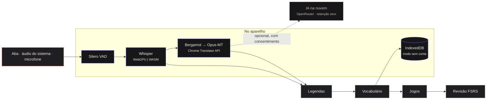

<div align="center">

# Frasy

**Aprenda um idioma com o que você já assiste, joga e conversa.**
Legendas e tradução ao vivo de qualquer áudio do seu computador, rodando **no seu próprio aparelho**, transformadas em jogos de vocabulário e repetição espaçada.

[🇺🇸 English](README.md) · [🇧🇷 Português](README.pt-BR.md) · [🇨🇳 中文](README.zh-CN.md) · [🇫🇷 Français](README.fr.md) · [🇪🇸 Español](README.es.md)

[](https://github.com/GuilhermeLVL/babel-play/actions/workflows/ci.yml)
[](https://github.com/GuilhermeLVL/babel-play/actions/workflows/seguranca.yml)
[](LICENSE)
[](package.json)


</div>

> **Estado (18/10/2026):** pré-lançamento. Cobrança, login e o deploy no Fly.io estão implementados e testados, mas ainda não rodaram em ambiente real. O [estado do lançamento](docs/ESTADO-DO-LANCAMENTO.md) é a fonte única do que vale hoje.

**Sumário:** [O que é](#o-que-é) · [Como rodar](#como-rodar) · [Arquitetura](#arquitetura) · [Planos e IA na nuvem](#planos-e-ia-na-nuvem) · [Self-host](#self-host) · [Deploy](#deploy) · [Segurança e privacidade](#segurança-e-privacidade) · [Contribuição](#contribuição) · [Licença](#licença)

## O que é

- **Legendas e tradução ao vivo** de uma aba do navegador, do áudio do sistema (loopback do Windows) ou do microfone. As legendas flutuantes ficam por cima do vídeo ou do jogo.
- **Modo intérprete**: duas pessoas que não falam a mesma língua conversam frente a frente com um aparelho só; a tradução é lida em voz alta (voz do aparelho no Grátis, voz natural da nuvem no Premium).
- **Estudo** com repetição espaçada FSRS-5 e uma trilha CEFR feita de listas de palavras reais, alimentada pelo que você ouviu.
- **Jogos**: nove jogos curtos feitos com o _seu_ vocabulário (memória, caça-palavras, ditado, duelo relâmpago, karaokê...). O que você acerta conta na revisão.
- **Importação** de baralhos Anki, documentos (`.txt`, `.pdf`, `.docx`) e legendas (`.srt`, `.vtt`, `.ass`), lidos no navegador.
- **Local-first**: os modelos rodam no aparelho (Whisper pelo transformers.js em WebGPU com reserva em WASM, Opus-MT e Bergamot, da Mozilla, para tradução rápida X→inglês). Sem conta, nada vai ao servidor.
- **Nuvem opcional** (OpenRouter, retenção zero de dados, com consentimento explícito) para mais qualidade quando você pedir.
- **Perfil protegido para menores**: sem compra, sem oferta, e IA na nuvem só com data de nascimento declarada.

## Como rodar

Requer Node 22 ou mais novo.

```bash
npm install          # também copia os binários do ONNX Runtime / Silero VAD para public/
cp .env.example .env # defina PORT; o pipeline local não precisa de chave de API
npm run dev          # Express + Vite num processo só → http://localhost:<PORT>
```

Abra por `localhost` (contexto seguro, exigido pelos modelos). Se o seu `.env` tem `VITE_AUTH_REQUIRED=1`, use `npm run dev:local`: sobe o mesmo app com o login desligado, para inspeção local. Na tela de login, escolha **Continuar sem conta** para usar todo o pipeline local.

| Comando                             | O que faz                                                                                  |
| ----------------------------------- | ------------------------------------------------------------------------------------------ |
| `npm run dev` / `npm run dev:local` | servidor de desenvolvimento (o segundo com o login desligado)                              |
| `npm test`                          | testes unitários e de integração (Vitest)                                                  |
| `npm run test:e2e`                  | testes ponta a ponta (Playwright)                                                          |
| `npm run lint`                      | ESLint, sem nenhum aviso permitido                                                         |
| `npm run typecheck`                 | TypeScript (também `typecheck:core` e `typecheck:estrito`)                                 |
| `npm run build`                     | bundle do cliente (`dist/`) e do servidor (`dist-server/`)                                 |
| `npm run vitrine`                   | modo público completo com login e cobrança de mentira ([docs/vitrine.md](docs/vitrine.md)) |

A lista completa que a CI roda está em [CONTRIBUTING.md](CONTRIBUTING.md) (em inglês).

## Arquitetura



O código é dividido em camadas:

| Caminho           | Papel                                                                                                                                                                          |
| ----------------- | ------------------------------------------------------------------------------------------------------------------------------------------------------------------------------ |
| `src/core/`       | lógica de domínio pura (planos, FSRS, jogos, economia, regras de tradução); sem DOM, sem rede                                                                                  |
| `src/gateway/`    | adaptadores de fala para texto e de tradução, cache de modelos, roteamento e reservas entre provedores                                                                         |
| `src/lib/`        | serviços do cliente: captura, áudio, voz, importação, autenticação                                                                                                             |
| `src/data/`       | a camada de dados. O `apiFetch` é o **funil HTTP único**; sem conta, um servidor em memória sobre o IndexedDB (`src/data/efemero`) responde com os mesmos formatos de resposta |
| `src/components/` | interface em React                                                                                                                                                             |
| `server/`         | API Express: JWT do Supabase, isolamento por usuário, limites de taxa, validação com Zod, libsql/SQLite (Drizzle), cobrança, roteamento de IA                                  |

Identidade (anônima ou com conta), plano e papel são eixos separados, e o plano é decidido **só** no servidor; o cliente apenas o pinta. Uma regra do ast-grep proíbe `fetch('/api/…')` fora do funil. Mais em [docs/arquitetura.md](docs/arquitetura.md) (histórico) e nas specs vivas em [`openspec/specs/`](openspec/specs/).

## Planos e IA na nuvem

| Plano       | O que você recebe                                                                                                                                                                          |
| ----------- | ------------------------------------------------------------------------------------------------------------------------------------------------------------------------------------------ |
| **Grátis**  | Tudo o que roda no aparelho (captura, modelos locais, estudo, jogos). Sem IA gerenciada na nuvem.                                                                                          |
| **Premium** | Transcrição e tradução na nuvem com uso justo diário e mensal, voz natural no intérprete. Começa com um teste sem cartão, que acaba em 14 dias ou na franquia de uso, o que vier primeiro. |

A IA na nuvem passa pelo OpenRouter com retenção zero de dados e só depois do consentimento. Preços, cotas e as decisões por trás estão em [docs/ESTADO-DO-LANCAMENTO.md](docs/ESTADO-DO-LANCAMENTO.md) e [docs/monetizacao.md](docs/monetizacao.md). O pagamento é pelo Asaas, e quem concede o plano é o webhook do pagamento.

## Self-host

Docker (no macOS, o OrbStack serve) com o modo público multiusuário:

```bash
cp .env.docker.example .env.docker   # preencha os valores do Supabase
docker compose --env-file .env.docker up -d --build
curl -fsS http://localhost:3000/api/health
```

O HTTPS fica por conta do proxy reverso na frente (Caddy, Traefik, nginx). Detalhes no [`docker-compose.yml`](docker-compose.yml) e em [docs/deploy.md](docs/deploy.md).

## Deploy

O destino de produção é o Fly.io (GRU, uma máquina, SQLite replicado pelo Litestream para o Cloudflare R2), com Supabase para o login, Cloudflare na frente, Resend e Sentry. O passo a passo do dono é [docs/LANCAMENTO.md](docs/LANCAMENTO.md); operar é [docs/runbook.md](docs/runbook.md); o staging é [docs/STAGING.md](docs/STAGING.md). O deploy passa pelo `deploy.yml`, que só aceita um commit com a CI verde.

## Segurança e privacidade

- Vulnerabilidades se reportam em privado; veja [SECURITY.md](SECURITY.md).
- Registros da LGPD (registro das operações de tratamento e operadores): [docs/lgpd/](docs/lgpd/).
- O modo sem conta envia **zero** requisições a `/api`; nada digitado pelo usuário chega aos logs; o áudio só é guardado pelo tempo que a política de retenção diz.
- A CI roda SAST (Semgrep), auditoria de dependências com lista de exceções nomeada, varredura de segredos, Trivy na imagem e uma sonda de ataques ao JWT.
- O método de auditoria está em [docs/metodologia-de-auditoria.md](docs/metodologia-de-auditoria.md); as auditorias datadas estão em [docs/auditoria/](docs/auditoria/).

## Limites conhecidos

- O Opus-MT int8/fp16 não monta a sessão em alguns aparelhos; o app cai para o próximo tradutor.
- O áudio de compartilhamento de tela no Windows pode dar `NotReadableError`; use o compartilhamento de aba ou o loopback.
- Banco com um único escritor (SQLite): serve para um beta; escalar significa trocar o banco, veja [docs/escala.md](docs/escala.md).
- Os modelos do Bergamot saem de um CDN que o dono ainda precisa publicar; até lá, o Opus-MT faz o trabalho.

## Contribuição

Leia o [CONTRIBUTING.md](CONTRIBUTING.md) e o [Código de Conduta](CODE_OF_CONDUCT.md). Mudanças de comportamento em sistemas existentes passam pelo [OpenSpec](openspec/) (`/opsx:propose`). Um hook de pré-commit ([Husky](.husky/pre-commit) + lint-staged) formata e roda o lint no que está no índice. O índice de toda a documentação é [docs/README.md](docs/README.md); as atribuições dos dados estão em [docs/FONTES.md](docs/FONTES.md).

## Licença

[MIT](LICENSE).
