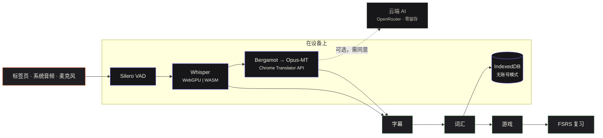

<div align="center">

# Babel Play

**用你已经在看、在玩、在聊的内容来学语言。**
为电脑上的任何音频提供实时字幕和翻译，**在你自己的设备上运行**，并转化为词汇游戏和间隔重复复习。

[🇺🇸 English](README.md) · [🇧🇷 Português](README.pt-BR.md) · [🇨🇳 中文](README.zh-CN.md) · [🇫🇷 Français](README.fr.md) · [🇪🇸 Español](README.es.md)

[](https://github.com/GuilhermeLVL/babel-play/actions/workflows/ci.yml)
[](https://github.com/GuilhermeLVL/babel-play/actions/workflows/seguranca.yml)
[](LICENSE)
[](package.json)


</div>

> **状态（2026-10-18）：** 发布前。计费、登录和 Fly.io 部署均已实现并通过测试，但尚未在真实环境中运行。[发布状态](docs/ESTADO-DO-LANCAMENTO.md)（葡萄牙语）是当前有效内容的唯一来源。

**目录：** [这是什么](#这是什么) · [如何运行](#如何运行) · [架构](#架构) · [套餐与云端 AI](#套餐与云端-ai) · [自托管](#自托管) · [部署](#部署) · [安全与隐私](#安全与隐私) · [参与贡献](#参与贡献) · [许可证](#许可证)

## 这是什么

- **实时字幕和翻译**：来源可以是浏览器标签页、系统音频（Windows loopback）或麦克风。悬浮字幕显示在视频或游戏之上。
- **口译模式**：两个语言不通的人用一台设备面对面交谈；译文会被朗读出来（免费版使用设备自带语音，Premium 使用云端自然语音）。
- **学习**：采用 FSRS-5 间隔重复，以及基于真实词表构建的 CEFR 路径，内容来自你听到的话。
- **游戏**：九个用*你自己的*词汇生成的短游戏（记忆配对、找单词、听写、闪电对决、卡拉 OK 等）。答对的内容会计入复习。
- **导入**：Anki 牌组、文档（`.txt`、`.pdf`、`.docx`）和字幕（`.srt`、`.vtt`、`.ass`），均在浏览器中读取。
- **本地优先**：模型在设备上运行（通过 transformers.js 使用 WebGPU 的 Whisper，WASM 作为后备；Opus-MT；以及 Mozilla 的 Bergamot，用于快速的 X→英语翻译）。没有账号时，不会向服务器发送任何数据。
- **可选云端**（OpenRouter，零数据留存，需明确同意）：在你需要时提供更高质量。
- **未成年人保护档案**：不能购买、没有促销，且仅在声明出生日期后才使用云端 AI。

## 如何运行

需要 Node 22 或更高版本。

```bash
npm install          # 同时把 ONNX Runtime / Silero VAD 二进制文件复制到 public/
cp .env.example .env # 设置 PORT；本地管线不需要 API 密钥
npm run dev          # Express + Vite 在同一进程中 → http://localhost:<PORT>
```

请通过 `localhost` 打开（安全上下文，模型需要）。如果你的 `.env` 中有 `VITE_AUTH_REQUIRED=1`，请改用 `npm run dev:local`：它以关闭登录的方式启动同一应用，便于本地检查。在登录界面选择 **不登录继续** 即可使用完整的本地管线。

| 命令                                | 作用                                                                     |
| ----------------------------------- | ------------------------------------------------------------------------ |
| `npm run dev` / `npm run dev:local` | 开发服务器（后者关闭登录）                                               |
| `npm test`                          | 单元与集成测试（Vitest）                                                 |
| `npm run test:e2e`                  | 端到端测试（Playwright）                                                 |
| `npm run lint`                      | ESLint，不允许任何警告                                                   |
| `npm run typecheck`                 | TypeScript（另有 `typecheck:core` 和 `typecheck:estrito`）               |
| `npm run build`                     | 客户端包（`dist/`）和服务器包（`dist-server/`）                          |
| `npm run vitrine`                   | 带模拟登录和模拟计费的完整公开模式（[docs/vitrine.md](docs/vitrine.md)） |

CI 运行的完整清单见 [CONTRIBUTING.md](CONTRIBUTING.md)（英文）。

## 架构



代码按层划分：

| 路径              | 作用                                                                                                                           |
| ----------------- | ------------------------------------------------------------------------------------------------------------------------------ |
| `src/core/`       | 纯领域逻辑（套餐、FSRS、游戏、经济、翻译规则）；不依赖 DOM，不访问网络                                                         |
| `src/gateway/`    | 语音转文字与翻译的适配器、模型缓存、路由以及提供方之间的后备                                                                   |
| `src/lib/`        | 客户端服务：采集、音频、语音、导入、认证                                                                                       |
| `src/data/`       | 数据层。`apiFetch` 是**唯一的 HTTP 漏斗**；没有账号时，由 IndexedDB 之上的内存服务器（`src/data/efemero`）以相同的响应格式作答 |
| `src/components/` | React 界面                                                                                                                     |
| `server/`         | Express API：Supabase JWT、按用户隔离、速率限制、Zod 校验、libsql/SQLite（Drizzle）、计费、AI 路由                             |

身份（匿名或已登录）、套餐和角色是相互独立的维度，套餐**只**由服务器决定；客户端仅负责展示。ast-grep 规则禁止在漏斗之外使用 `fetch('/api/…')`。更多内容见 [docs/arquitetura.md](docs/arquitetura.md)（历史文档）以及 [`openspec/specs/`](openspec/specs/) 中的现行规格。

## 套餐与云端 AI

| 套餐        | 你得到什么                                                                                                                  |
| ----------- | --------------------------------------------------------------------------------------------------------------------------- |
| **免费**    | 所有在设备上运行的功能（采集、本地模型、学习、游戏）。没有托管的云端 AI。                                                   |
| **Premium** | 云端转写与翻译，按日和按月的合理使用额度，口译的自然语音。以无需绑卡的试用开始，14 天后或用完使用额度时结束，以先到者为准。 |

云端 AI 通过 OpenRouter 调用，零数据留存，且仅在获得同意后使用。价格、额度及其背后的决定见 [docs/ESTADO-DO-LANCAMENTO.md](docs/ESTADO-DO-LANCAMENTO.md) 和 [docs/monetizacao.md](docs/monetizacao.md)。支付通过 Asaas，由支付 webhook 授予套餐。

## 自托管

使用 Docker（macOS 上可用 OrbStack）运行多用户公开模式：

```bash
cp .env.docker.example .env.docker   # 填写 Supabase 的值
docker compose --env-file .env.docker up -d --build
curl -fsS http://localhost:3000/api/health
```

HTTPS 由前置的反向代理负责（Caddy、Traefik、nginx）。详情见 [`docker-compose.yml`](docker-compose.yml) 和 [docs/deploy.md](docs/deploy.md)。

## 部署

生产目标是 Fly.io（GRU，一台机器，SQLite 由 Litestream 复制到 Cloudflare R2），使用 Supabase 登录，前置 Cloudflare，并配合 Resend 和 Sentry。所有者的分步指南是 [docs/LANCAMENTO.md](docs/LANCAMENTO.md)；运维见 [docs/runbook.md](docs/runbook.md)；预发布环境见 [docs/STAGING.md](docs/STAGING.md)。部署经由 `deploy.yml`，它只接受 CI 为绿色的提交。

## 安全与隐私

- 漏洞请私下报告；见 [SECURITY.md](SECURITY.md)。
- LGPD 记录（数据处理登记与处理方）：[docs/lgpd/](docs/lgpd/)。
- 无账号模式向 `/api` 发送**零**请求；用户输入的内容不会进入日志；音频仅按留存政策规定的时间保存。
- CI 运行 SAST（Semgrep）、带具名例外清单的依赖审计、密钥扫描、对镜像的 Trivy 扫描以及 JWT 攻击探测。
- 审计方法见 [docs/metodologia-de-auditoria.md](docs/metodologia-de-auditoria.md)；带日期的审计见 [docs/auditoria/](docs/auditoria/)。

## 已知限制

- Opus-MT int8/fp16 在部分设备上无法创建会话；应用会回退到下一个翻译器。
- Windows 上共享屏幕的音频可能抛出 `NotReadableError`；请改用共享标签页或 loopback。
- 单写入者数据库（SQLite）：测试阶段够用；扩容意味着更换数据库，见 [docs/escala.md](docs/escala.md)。
- Bergamot 模型由一个 CDN 提供，所有者尚需发布；在此之前由 Opus-MT 承担翻译。

## 参与贡献

请阅读 [CONTRIBUTING.md](CONTRIBUTING.md) 和[行为准则](CODE_OF_CONDUCT.md)。对现有系统行为的修改需通过 [OpenSpec](openspec/)（`/opsx:propose`）。预提交钩子（[Husky](.husky/pre-commit) + lint-staged）会对暂存内容进行格式化和 lint。全部文档的索引是 [docs/README.md](docs/README.md)；数据署名见 [docs/FONTES.md](docs/FONTES.md)（葡萄牙语）。

## 许可证

[MIT](LICENSE)。
